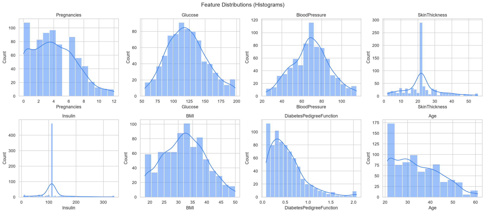
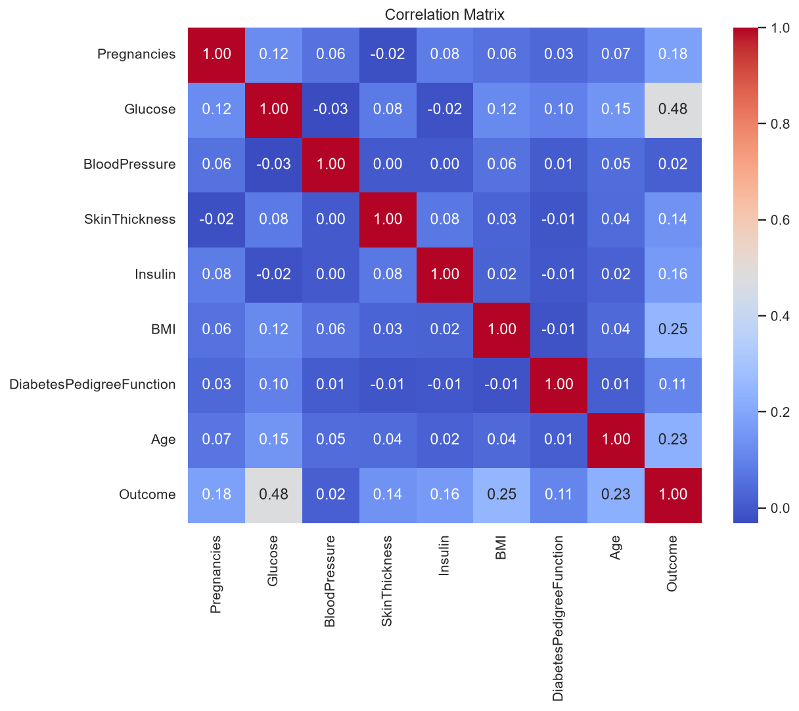
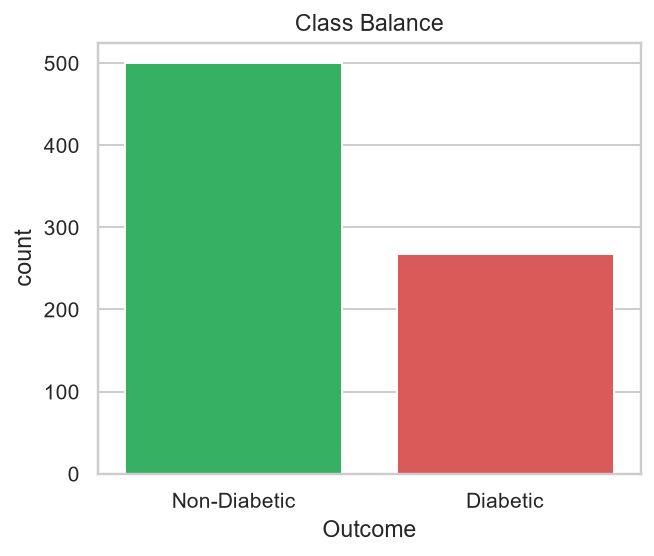
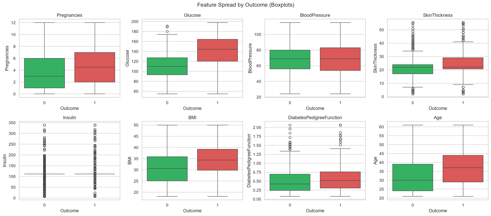
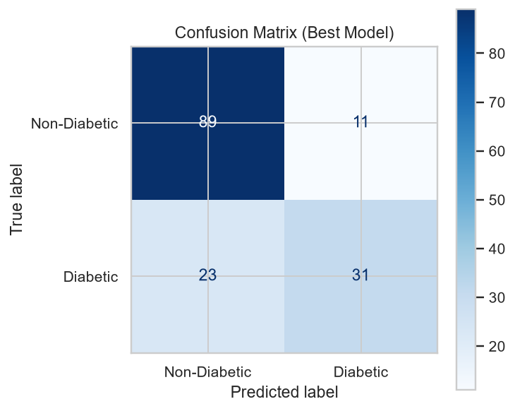
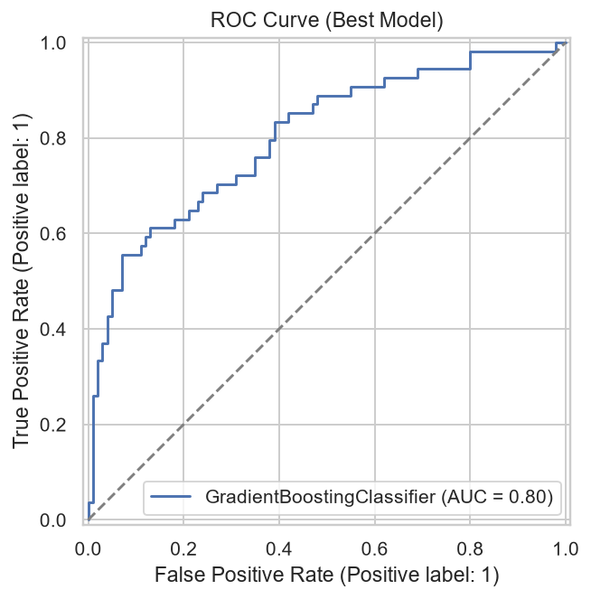

# 🩺 Diabetes Prediction & Patient Management Desktop App

A complete, end-to-end machine learning desktop application that predicts a
patient's likelihood of diabetes from clinical measurements, built on the
Pima Indians Diabetes Dataset. Designed as a portfolio-ready project for
Data Analyst / Data Scientist / ML Engineer roles.

> ⚠️ **Educational project.** Predictions are for demonstration purposes
> only and are not a substitute for professional medical diagnosis.

---

## ✨ Features

- **Six ML models trained & compared** — Logistic Regression, Decision Tree,
  Random Forest, SVM, KNN, Gradient Boosting — with the best model chosen
  automatically by F1 score.
- **Modern desktop GUI** built with CustomTkinter: splash screen, login,
  registration, forgot-password flow, and a sidebar-navigated dashboard
  (Overview, New Prediction, History, About, Help) with light/dark theme.
- **SQLite-backed accounts & history** — hashed passwords (PBKDF2-HMAC-SHA256
  + per-user salt), per-user prediction history with search, delete, clear,
  and CSV export.
- **Input validation & security** — range/type checks on all 8 clinical
  fields, SQL-injection pattern rejection, and parameterised queries at the
  database layer.
- **Risk-banded results** — Green / Yellow / Red risk levels with lifestyle
  suggestions (diet, exercise, doctor consultation).
- **Full EDA & evaluation suite** — histograms, correlation heatmap, boxplots,
  KDE distributions, feature importance, confusion matrix, ROC curve.
- **30 passing unit tests** covering validators, the ML predictor, and the
  full database lifecycle.

---

## 🖼️ Screenshots

EDA and model-evaluation plots (generated by `model/evaluate_model.py`):

| | |
|---|---|
|  |  |
|  |  |
|  |  |

See [`docs/screenshots.md`](docs/screenshots.md) for the full list, and add
your own captures of the running desktop app there too.

---

## 🧰 Tech Stack

| Layer | Tools |
|---|---|
| Language | Python 3.12+ |
| ML | scikit-learn, pandas, NumPy, joblib |
| Visualization | matplotlib, seaborn |
| GUI | CustomTkinter |
| Database | SQLite |
| Testing | unittest |

---

## 📦 Installation

```bash
git clone https://github.com/<your-username>/Diabetes-Prediction.git
cd Diabetes-Prediction
python -m venv venv && source venv/bin/activate   # Windows: venv\Scripts\activate
pip install -r requirements.txt
```

Full details, including how to swap in the real Kaggle/UCI dataset, are in
[`docs/installation.md`](docs/installation.md).

## ▶️ How to Run

```bash
# 1. Train the model (creates model/diabetes_model.pkl + scaler.pkl)
python model/train_model.py

# 2. (Optional) generate EDA/evaluation plots into /screenshots
python model/evaluate_model.py

# 3. Launch the desktop app
python app/main.py

# 4. Run the test suite
python -m unittest discover tests
```

## 🌐 Live Demo / Deployment

**Live demo:** `https://<your-render-service>.onrender.com` (replace this
placeholder with the URL Render assigns after deployment).

To deploy the Flask web app on Render:

1. Push this project to a GitHub repository, including the trained
   `model/diabetes_model.pkl` and `model/scaler.pkl` artifacts.
2. In Render, choose **New + → Blueprint**, connect the repository, and
   apply the settings in `render.yaml`.
3. Render installs `requirements.txt`, starts the Flask app with Gunicorn,
   generates `SECRET_KEY`, and checks `/health`. After deployment, copy the
   public URL into the placeholder above.

Only the Flask web app is deployed; the CustomTkinter desktop GUI is not
served on Render. This educational project uses a synthetic dataset, and
its predictions are not medical diagnoses or advice.

On Render's free web-service plan, the service may take around a minute to
wake after about 15 minutes without traffic. Its filesystem is ephemeral:
SQLite account and prediction data can reset after a restart or redeploy.
Do not use the free service for persistent or real patient data. To use a
persistent Render disk later, set `DATABASE_PATH` to a file inside its mount
directory; the database layer creates the parent directory. SQLite is intended
for this single-instance educational demo, not multi-instance production use.

---

## 📁 Folder Structure

```
Diabetes-Prediction/
├── app/
│   ├── main.py          # CustomTkinter GUI: login, dashboard, prediction, history
│   ├── predictor.py      # Loads model/scaler, exposes predict()
│   ├── database.py       # SQLite: users, prediction_history, settings
│   ├── validators.py     # Field/form/auth validation, SQL-injection guards
│   ├── theme.py          # Colors, fonts, light/dark ThemeManager
│   ├── utils.py           # Logging, password hashing, risk suggestions
│   └── assets/            # SQLite DB file lives here at runtime
│
├── model/
│   ├── train_model.py    # Cleans data, trains & compares 6 models, persists best
│   ├── evaluate_model.py  # Generates all EDA/evaluation plots
│   ├── diabetes_model.pkl # Persisted best model (generated)
│   ├── scaler.pkl          # Persisted StandardScaler (generated)
│   └── metrics.json        # Comparison metrics for all 6 models (generated)
│
├── data/
│   ├── diabetes.csv       # Raw dataset (synthetic stand-in — see docs/installation.md)
│   └── processed.csv       # Cleaned dataset (generated)
│
├── notebooks/
│   └── EDA.ipynb           # Interactive exploratory data analysis
│
├── screenshots/            # Generated EDA/evaluation plots
├── tests/
│   ├── test_predictor.py   # Predictor + database unit tests
│   └── test_validator.py   # Validation unit tests
│
├── docs/
│   ├── architecture.md     # Layered architecture & module responsibilities
│   ├── workflow.md          # ML + app + testing workflow, step by step
│   ├── installation.md      # Setup, dataset, troubleshooting
│   └── screenshots.md        # Plot/screenshot index
│
├── requirements.txt
├── README.md
├── LICENSE
└── .gitignore
```

---

## 📊 Model Performance

Trained and compared on an 80/20 stratified split (see
[`docs/workflow.md`](docs/workflow.md) for full methodology). Best model
selected by **F1 score**, since the dataset is moderately imbalanced.

| Model | Accuracy | Precision | Recall | F1 | ROC-AUC |
|---|---|---|---|---|---|
| **Gradient Boosting** ⭐ | 0.786 | 0.756 | 0.574 | **0.653** | 0.803 |
| Support Vector Machine | 0.786 | 0.769 | 0.556 | 0.645 | 0.818 |
| Logistic Regression | 0.779 | 0.750 | 0.556 | 0.638 | 0.794 |
| K-Nearest Neighbours | 0.753 | 0.735 | 0.463 | 0.568 | 0.796 |
| Random Forest | 0.753 | 0.750 | 0.444 | 0.558 | 0.819 |
| Decision Tree | 0.695 | 0.590 | 0.426 | 0.495 | 0.672 |

> These figures come from the bundled synthetic dataset (see note below) and
> will change once you retrain on the real dataset — re-run
> `python model/train_model.py` and this table will regenerate in
> `model/metrics.json`.

### ⚠️ A note on the dataset

This environment could not reach the internet to download the real Kaggle/UCI
Pima Indians Diabetes Dataset, so `data/diabetes.csv` ships with a
**statistically-realistic synthetic stand-in** — same 8 columns, matching
published feature means/std-devs and a matching ~35% diabetic rate — so the
full pipeline (cleaning → training → evaluation → app) runs correctly out of
the box. For a genuine portfolio/interview submission, swap in the real file
(same column names) as described in
[`docs/installation.md`](docs/installation.md) and retrain.

---

## 🚀 Future Improvements

- Package as a standalone `.exe`/`.app` with PyInstaller.
- Add PDF report generation for individual predictions.
- Add a prediction-confidence gauge widget.
- Model monitoring / drift detection if retrained periodically.
- Multi-language support.

---

## 🧪 Testing

```bash
python -m unittest discover tests
```

30 tests covering:
- Field-level and form-level input validation (ranges, types, SQL-injection patterns)
- Auth validation (username/password/email rules)
- Model loading and inference sanity checks
- Full database lifecycle: user creation, authentication, password reset,
  prediction history CRUD, settings persistence

---

## 📄 License

[MIT](LICENSE)

## 👤 Author

Built as a portfolio project demonstrating full-stack ML application
development: data cleaning, multi-model comparison, desktop GUI design,
secure data persistence, and test coverage.
